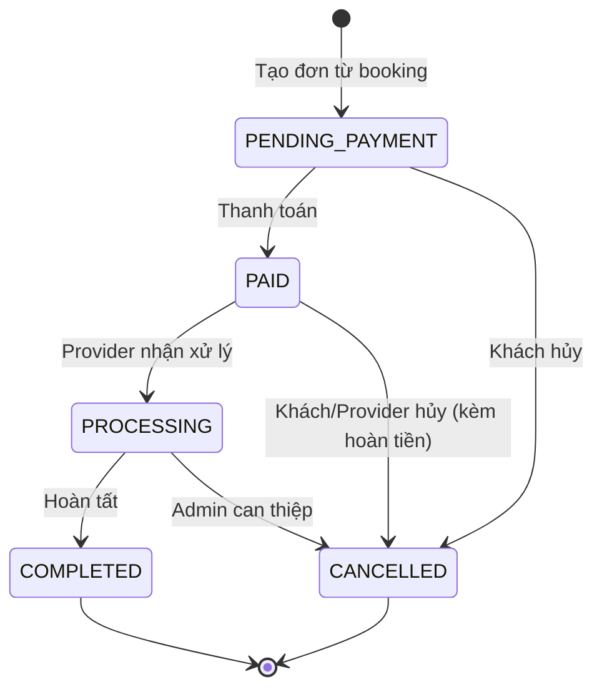

# SkillShare — Nền tảng thuê dịch vụ kỹ năng

Đồ án cuối kỳ — **Nhóm 4**. Website kết nối **Customer** (khách đặt dịch vụ) với **Provider** (người cung cấp kỹ năng), có **Admin** quản trị. Luồng chính:

```
Customer → Chọn dịch vụ → Booking → Rental Order → Payment → Hoàn tất → Review
```

## Công nghệ

- Java 17, Spring Boot 3.3.5 (Web MVC, Security, Data JPA, Validation)
- Thymeleaf, CSS thuần (không cần Node.js)
- H2 (mặc định, phát triển) và MySQL 8.0.16+ (profile `mysql`, demo/nộp bài)
- Maven, Lombok

## Thành viên và phân công

| Thành viên | Module | Chức năng bắt buộc | Chức năng tự chọn |
|---|---|---|---|
| Huỳnh Hoài Thương | Authentication + User | Đăng ký + email xác nhận, đăng nhập, đăng xuất, lấy lại mật khẩu, admin quản lý người dùng | Cập nhật thông tin cá nhân, đăng nhập Google |
| Lê Tuấn Anh | Service + Provider | Xem chi tiết dịch vụ/provider, admin quản lý dịch vụ/provider, provider quản lý dịch vụ | Lọc theo kỹ năng/giá, sắp xếp theo giá/đánh giá, dịch vụ/provider gợi ý |
| Nguyễn Khoa Đăng | Cart + Booking + Order | Giỏ/danh sách dịch vụ đã chọn, đặt dịch vụ, admin quản lý đơn hàng, provider quản lý booking/đơn | Cập nhật trạng thái đơn, hủy đơn, hoàn tiền (cùng Nhật Anh) |
| Châu Nguyễn Nhật Anh | Payment + History + Statistics | Thanh toán trực tuyến, lịch sử đặt dịch vụ, biểu đồ cột theo thời gian, biểu đồ tròn, provider xem doanh thu | Dịch vụ được đặt nhiều, đánh giá dịch vụ/provider, báo cáo khách hàng/provider, hoàn tiền (cùng Khoa Đăng) |

Phân quyền Admin theo domain: User → Thương · Service/Provider → Tuấn Anh · Order → Khoa Đăng · Statistics → Nhật Anh.

### Tiến độ chức năng

Đánh dấu `[x]` khi đã merge vào `main` và chạy được.

**Thương** — [ ] Đăng ký + email xác nhận · [ ] Đăng nhập · [ ] Đăng xuất · [ ] Quên mật khẩu · [ ] Admin quản lý người dùng · [ ] Cập nhật thông tin cá nhân · [ ] Đăng nhập Google

**Tuấn Anh** — [ ] Chi tiết dịch vụ/provider · [ ] Admin quản lý dịch vụ/provider · [ ] Provider quản lý dịch vụ · [ ] Lọc kỹ năng/giá · [ ] Sắp xếp giá/đánh giá · [ ] Gợi ý

**Khoa Đăng** — [ ] Giỏ dịch vụ · [ ] Đặt dịch vụ · [ ] Admin quản lý đơn · [ ] Provider quản lý booking/đơn · [ ] Cập nhật trạng thái đơn · [ ] Hủy đơn · [ ] Hoàn tiền

**Nhật Anh** — [ ] Thanh toán · [ ] Lịch sử đặt dịch vụ · [ ] Biểu đồ cột · [ ] Biểu đồ tròn · [ ] Doanh thu provider · [ ] Dịch vụ được đặt nhiều · [ ] Đánh giá · [ ] Báo cáo · [ ] Hoàn tiền

> Source hiện tại đã có sẵn khung giao diện, entity, schema 24 bảng, dữ liệu mẫu và luồng đặt dịch vụ → đơn hàng → thanh toán (mô phỏng) cho một dịch vụ. Các mục trên là phần nhóm cần hoàn thiện/nghiệm thu.

## Trạng thái đơn hàng



Trạng thái `Booking`: `PENDING → CONFIRMED → IN_PROGRESS → COMPLETED` (hoặc `CANCELLED`), luôn đồng bộ với đơn. Mọi thay đổi trạng thái đều đi qua một service duy nhất và được ghi vào `rental_order_status_history`. *(Bảng chuyển trạng thái do nhóm thống nhất ở Giai đoạn 1.)*

## Yêu cầu môi trường

- JDK 17+
- Maven 3.9+ (hoặc dùng Maven tích hợp trong IntelliJ)
- (Tuỳ chọn) MySQL 8.0.16+ hoặc Docker nếu muốn chạy profile `mysql`

## Chạy nhanh với H2 (không cần cài database)

```bash
cd skill-rental
mvn spring-boot:run
```

Mở http://localhost:8080. Dữ liệu mẫu được tạo tự động khi khởi động và **mất khi tắt ứng dụng**.

H2 console: http://localhost:8080/h2-console — JDBC URL `jdbc:h2:mem:skillrental`, user `sa`, mật khẩu để trống.

## Chạy với MySQL

H2 tự sinh bảng từ entity, còn profile `mysql` dùng `ddl-auto=validate` nên **entity phải khớp `schema-mysql.sql`**. Khi sửa entity/cột, cập nhật luôn file schema.

**1. Khởi động MySQL 8** (ví dụ bằng Docker):

```bash
docker run --name skillshare-mysql -e MYSQL_ROOT_PASSWORD=123456 -p 3306:3306 -d mysql:8.0
```

**2. Tạo schema** (phải làm trước khi chạy ứng dụng):

```bash
docker exec -i skillshare-mysql mysql -uroot -p123456 < skill-rental/src/main/resources/db/schema-mysql.sql
```

Nếu dùng MySQL cài sẵn: `mysql -u root -p < skill-rental/src/main/resources/db/schema-mysql.sql`. Trên PowerShell dùng `Get-Content <file> | docker exec -i skillshare-mysql mysql -uroot -p123456`.

**3. Chạy ứng dụng:**

```bash
cd skill-rental
DB_USERNAME=root DB_PASSWORD=123456 mvn spring-boot:run -Dspring-boot.run.profiles=mysql
```

(Windows PowerShell: `$env:DB_USERNAME="root"; $env:DB_PASSWORD="123456"; mvn spring-boot:run "-Dspring-boot.run.profiles=mysql"`.)

Khi bảng `users` rỗng, ứng dụng tự nạp dữ liệu mẫu (`DemoDataConfig`). Nếu muốn nạp bằng SQL thay vì để ứng dụng tự nạp thì chạy `seed-demo-data.sql` **một lần, trước khi chạy ứng dụng lần đầu**; không chạy cả hai.

> Lưu ý về XAMPP: XAMPP đi kèm MariaDB, không phải MySQL 8, và nhóm chưa kiểm thử schema trên MariaDB. Nên dùng MySQL 8 (Docker hoặc MySQL Installer). Nếu đang bật MySQL của XAMPP thì tắt đi để khỏi trùng cổng 3306.

## Tài khoản demo

Mật khẩu mọi tài khoản: `123456`

| Vai trò | Email |
|---|---|
| Customer | `customer@skillrental.vn` |
| Provider | `provider1@skillrental.vn` |
| Admin | `admin@skillrental.vn` |

Dữ liệu mẫu có thêm 98 tài khoản giả lập trạng thái `LOCKED` (email `.invalid`) để mỗi bảng có ít nhất 50 bản ghi; đây không phải tài khoản đăng nhập. Mã thanh toán/OAuth/hoàn tiền chỉ là giá trị minh hoạ.

Mã giảm giá demo: `WELCOME10` (giảm 10%), `SKILL20` (giảm 20%).

## Cấu trúc thư mục

```text
skill-rental/
├── docs/                         # Thiết kế DB, ERD, thống kê seed
├── src/main/java/com/skillrental
│   ├── config/                   # SecurityConfig, DemoDataConfig
│   ├── controller/               # Auth, Booking, Order, Marketplace, ...
│   ├── dto/                      # Form/request
│   ├── entity/                   # JPA entity + enum (24 bảng)
│   ├── repository/
│   ├── service/
│   └── workspace/                # Trang làm việc Provider / Admin
├── src/main/resources
│   ├── application.properties            # H2 (mặc định)
│   ├── application-mysql.properties      # MySQL
│   ├── db/                               # schema-mysql.sql, seed, migration
│   ├── static/                           # css, js
│   └── templates/                        # Thymeleaf
└── src/test/java                 # Test
```

## Tài liệu cơ sở dữ liệu

- [Thiết kế DB và đối chiếu chức năng](skill-rental/docs/DATABASE_DESIGN.md)
- [ERD (PNG)](skill-rental/docs/skillshare-erd.png) · [SVG](skill-rental/docs/skillshare-erd.svg) · [Mermaid](skill-rental/docs/skillshare-erd.mmd)
- [Thống kê dữ liệu mẫu](skill-rental/docs/DEMO_SEED_DATA_SUMMARY.md) · [SQL kiểm tra số bản ghi](skill-rental/docs/verify-seed-counts.sql)

## Quy trình làm việc nhóm (Git)

1. Mỗi người làm **một module hoàn chỉnh** (entity/repository → service/controller → giao diện → test), không chia kiểu "một người backend, một người frontend".
2. Nhánh riêng cho từng nhóm việc: `feature/<ten>-<module>`, ví dụ `feature/dang-cart`. Không commit trực tiếp lên `main`.
3. Commit nhỏ, theo mẫu `loại(phạm-vi): mô tả` — loại gồm `feat`, `fix`, `refactor`, `test`, `docs`, `chore`. Ví dụ: `feat(cart): thêm CartService`.
4. Trước khi push: `git fetch && git rebase origin/main`, chạy `mvn test` phải xanh. Mở Pull Request và nhờ ít nhất một thành viên review.
5. Các bảng/enum dùng chung (`users`, `bookings`, `rental_orders`, `payments`) phải thống nhất tên và API **trước khi code**. Hạn chế nhiều người cùng sửa một file cấu hình hoặc `WorkspaceController.java`; ưu tiên viết service/controller riêng của module mình.
6. Đặt tên theo bản chất SkillShare: "dịch vụ/provider" thay cho "sản phẩm/người bán"; "đặt dịch vụ" thay cho "mua hàng".

### Kế hoạch triển khai

| Giai đoạn | Nội dung | Thực hiện | Đầu ra |
|---|---|---|---|
| 1 | Chốt DB, enum, luồng, bảng chuyển trạng thái | Cả nhóm | ERD, entity, enum thống nhất |
| 2 | Làm module riêng | Từng thành viên | Backend + UI + validation + test cơ bản |
| 3 | Tích hợp | Cả nhóm | Booking → Order → Payment, phân quyền |
| 4 | Chức năng tự chọn | Theo module | Ưu tiên Google, lọc/sắp xếp, đánh giá, hủy đơn |
| 5 | Kiểm thử | Cả nhóm | Test chức năng, quyền, lỗi dữ liệu |
| 6 | Báo cáo + demo | Cả nhóm | Ảnh giao diện, DB, UML, kịch bản demo |

## Kiểm thử

```bash
cd skill-rental
mvn test
```

## Giao diện

Palette: `#16A34A`, `#15803D`, `#DCFCE7`, `#0F172A`, `#F8FAFC`, `#FFFFFF`, `#1E293B`, `#64748B`, `#E2E8F0`, `#22C55E`, `#F59E0B`, `#EF4444`, `#3B82F6`. Font Inter; nút cao 44px, bo góc 8px; card bo góc 12px, padding 20px.

- Trang công khai sau đăng nhập (Trang chủ, Tìm Provider, Chi tiết Provider, Đặt lịch, Thanh toán): Header + Footer, không Sidebar.
- Trang quản lý (Hồ sơ, Cài đặt, Request, Đơn hàng, Tiến độ, Đổi mật khẩu, Đánh giá, Khiếu nại): Sidebar + Footer, không Header.
- Chat là widget nổi trên mọi trang sau đăng nhập.
- Form thanh toán hiện là **mô phỏng**, chưa tích hợp cổng thanh toán thật.
